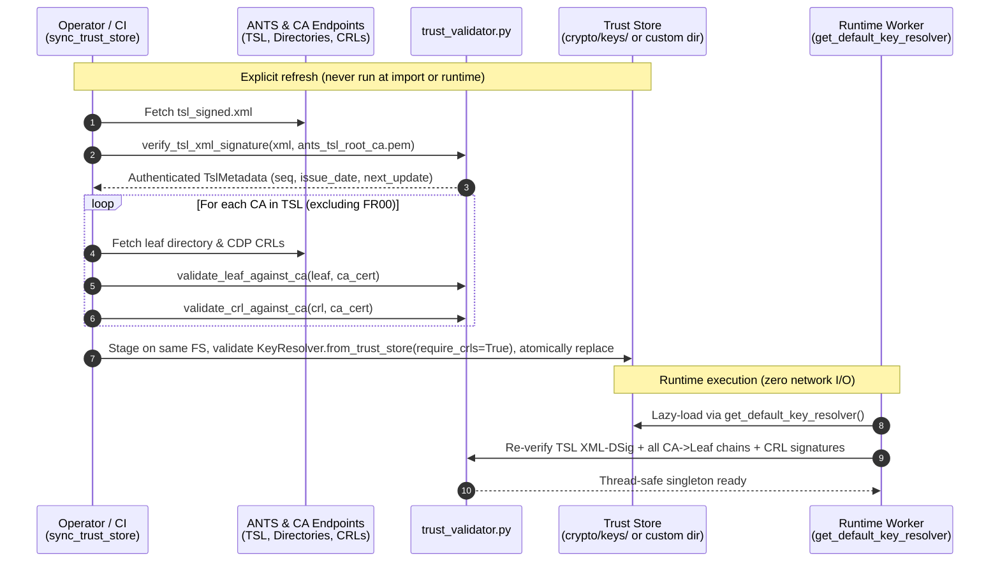
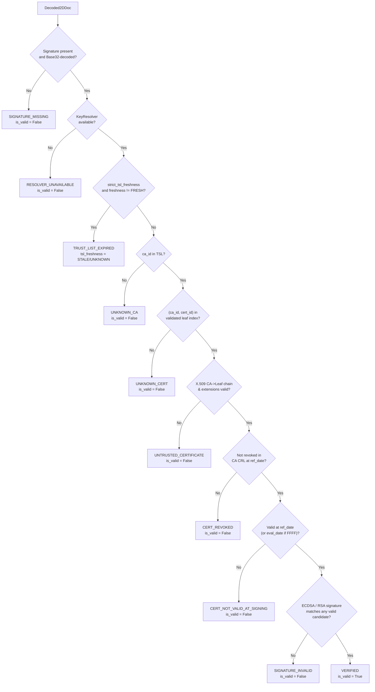

# PKI Trust Establishment & Verification Architecture

This document describes the cryptographic trust establishment, certificate chain validation, revocation checking, and offline trust-store architecture implemented in `fr_2ddoc_parser` (resolving [`etalab-ia/document-ia#161`](https://github.com/etalab-ia/document-ia/issues/161)).

---

## 1. Threat Model & Design Rationale

In the French ANTS 2D-Doc specification, barcodes are signed by **participant (leaf) certificates** issued by **Certification Authorities (CAs)** listed in the ANTS **Trust Service Status List (TSL)**. Mathematical signature verification alone (`ECDSA` / `RSA`) is insufficient if the origin, chain of trust, validity period, and revocation status of the signing public key are not authenticated.

Previous revisions (`v1.0.6` / `31ce018`) exhibited six security and operational flaws:
1. **Implicit network calls at import time**: Importing `fr_2ddoc_parser.api` triggered outbound HTTP requests and HTML link scraping across third-party CA directories (`TSPInformationURI`), risking MITM tampering and startup timeouts in ephemeral container environments (e.g. Scalingo).
2. **Missing X.509 chain verification**: Downloaded leaf certificates were indexed without verifying `verify_directly_issued_by(ca_cert)`, `BasicConstraints`, `KeyUsage`, or `AuthorityKeyIdentifier`.
3. **Permissive ID derivation and unsafe single-cert fallback**: `_derive_cert_ids()` created truncation collisions, and `KeyResolver.resolve()` silently fell back to the single CA certificate in the TSL whenever a `cert_id` was unknown, masking unknown keys as invalid signatures.
4. **Unverified & stale TSL**: The XML-DSig/XAdES signature on `tsl_signed.xml` was never checked, and `<tsl:NextUpdate>` expiration was ignored.
5. **No CRL revocation or signing-time validity checks**: Revoked leaf certificates still published in CA directories were accepted, and temporal validity at the document's signature/issue date was ignored.
6. **Collapsed failure semantics**: All errors were flattened into `is_valid = False` with `print()` output, preventing callers from distinguishing forged signatures, untrusted certificates, unknown keys, stale trust lists, and unavailable trust stores.

---

## 2. Trust Chain & Offline Snapshot Architecture

### 2.1. Packaged Offline Trust Store (`src/fr_2ddoc_parser/crypto/keys/`)

Runtime verification performs **zero outbound network requests**. A cryptographically pre-verified trust snapshot (~470 KB total, containing exclusively public certificates and public CRLs) is bundled inside the Python package and loaded lazily on first use:

| Artifact | Purpose |
|---|---|
| `ants_tsl_root_ca.pem` | Trust anchor (`CN=Autorité de Certification Services Applicatifs`, `2.5.4.5=4`) used to authenticate the TSL signer (`CN=ANTS CACHET 2DDOC`). |
| `tsl_signed.xml` | Official ANTS ETSI TS 102 231 TSL (Sequence 23, `NextUpdate: 2027-05-11T14:00:00Z`), verified via XML-DSig on every load. |
| `trusted_leaves/<CA_ID>.pem` | Verified leaf certificates per active CA (`FR01`, `FR03`, `FR04`, `FR05`, `FR06`, `FR07`, `FR09`), excluding test CA `FR00`. |
| `crls/<CA_ID>-<issuer-sha256>.crl` | DER-encoded Certificate Revocation Lists signed by each exact issuing certificate. Legacy `<CA_ID>.crl` filenames remain supported. |

An external directory can override the bundled snapshot via the `FR_2DDOC_TRUST_STORE_DIR` environment variable or by passing an explicit `KeyResolver` instance to `decode_2d_doc(..., key_resolver=...)`.

### 2.2. Trust Store Lifecycle (`sync_trust_store`)



---

## 3. Verification Decision Pipeline

When `decode_2d_doc()` or `Decoded2DDoc.verify()` executes, every verification passes through a strict ordered pipeline producing an immutable `VerificationResult`:



---

## 4. Security Controls Matrix

### 4.1. XML-DSig & XSW Hardening (`verify_tsl_xml_signature`)
- Rejects empty payloads and any `<!DOCTYPE` or `<!ENTITY` declaration before XML parsing.
- Enforces structural uniqueness: exactly one `<ds:Signature>` element whose direct parent is the root `<tsl:TrustServiceStatusList>` element (prevents XML Signature Wrapping attacks).
- Restricts algorithms to `RSA-SHA256/384/512`, `SHA-256/384/512` digests, and Inclusive C14N 1.0 (`REC-xml-c14n-20010315`) / Exclusive C14N 1.0 (`xml-exc-c14n#`), implemented with libxml2 through `lxml`.
- Supports enveloped-signature removal and the ANTS `xmldsig-filter2` subtract profile for `/descendant::ds:Signature`; unsupported or reordered transform chains are rejected rather than ignored.
- Requires `<ds:Reference URI="">` covering the full document (minus `<ds:Signature>`) and verifies every `#id`-targeted `<ds:Reference>` (including `<xades:SignedProperties>`) using constant-time `hmac.compare_digest`.
- Verifies the TSL signer certificate directly against `ants_tsl_root_ca.pem` (`BasicConstraints.ca` must not be `True`; `KeyUsage.digital_signature` is required; `AuthorityKeyIdentifier == root.SubjectKeyIdentifier` when both are present).
- Requires valid `tsl:ListIssueDateTime` and `tsl:NextUpdate` (`issue_date <= next_update`), and verifies that `xades:SigningTime` (or `tsl:ListIssueDateTime`) falls within the validity windows of both the TSL signer certificate and the ANTS root trust anchor.

### 4.2. X.509 Leaf & CRL Constraints (`validate_leaf_against_ca`, `validate_crl_against_ca`)
- Issuing CA certificate must possess `BasicConstraints(ca=True)` and `KeyUsage(key_cert_sign=True)` for leaves, and `BasicConstraints(ca=True)` and `KeyUsage(crl_sign=True)` for CRLs.
- Leaf certificate must satisfy `leaf_cert.verify_directly_issued_by(ca_cert)`.
- `BasicConstraints.ca` must be `False` on the leaf (if extension present).
- `KeyUsage.digital_signature` must be `True` on the leaf (extension required).
- `AuthorityKeyIdentifier.key_identifier` must match `ca_cert` `SubjectKeyIdentifier.digest` when both are present.
- `Subject` must contain a single `CommonName` (`CN`) matching `^[A-Za-z0-9]{4}$`, which serves as the sole authoritative `cert_id` lookup key (no heuristic truncation, no single-cert fallback).
- Each CRL must match `crl.issuer == ca_cert.subject`, pass `crl.is_signature_valid(ca_cert.public_key())`, and satisfy `last_update <= next_update`. CRLs are indexed by the SHA-256 fingerprint of the actual issuing certificate, not only by the four-character CA ID; serial-number collisions between issuers therefore cannot revoke each other's leaves.
- At verification, at least one CRL for that exact issuer must be applicable at the evaluation instant (`last_update <= evaluation <= next_update`). Missing, expired, future, or undated CRLs produce `RESOLVER_UNAVAILABLE`, never implicit non-revocation evidence.
- `KeyResolver.from_trust_store(..., require_crls=True)`, `from_network()`, and `sync_trust_store()` fail closed if any retained issuing certificate lacks a validated CRL. Network refresh and synchronization additionally require currently applicable CRLs. `require_crls=False` is an explicit opt-out for callers that intentionally do not want revocation enforcement.

### 4.3. Temporal Validity, Rotation & Revocation Rules
- **Reference date (`reference_date`)**: Derived from `header.signature_date` if present, else `header.issue_date`.
- **Historical validity & PrivateKeyUsagePeriod**: If `reference_date` is present, both the leaf certificate and the CA certificate must be valid at `reference_date`, and any `PrivateKeyUsagePeriod` (`2.5.29.16`) bounds on the leaf certificate must contain `reference_date`. **A document validly signed in the past remains `VERIFIED` even if the certificate has since expired.**
- **Certificate rotation**: Multiple leaf certificates sharing the same `(ca_id, cert_id)` (different serial numbers / validity periods) coexist in `KeyResolver`; verification evaluates all valid, non-revoked candidates for `reference_date` (including overlapping validity windows).
- **Undated headers (`FFFF`)**: When both `signature_date` and `issue_date` are `None`, validity is evaluated against `evaluation_date` (default: current UTC date).
- **Revocation evidence freshness (`evaluation_date`)**: CRL applicability is evaluated independently of both the document's signing date and the TSL's `NextUpdate`. A historically signed document therefore needs current revocation evidence at verification time; an old signed CRL alone is insufficient. An explicit date-only evaluation compares UTC calendar dates, while the default uses the actual UTC instant.
- **Revocation (`check_certificate_revocation`)**: A certificate listed in its exact issuer's applicable signed CRL is rejected with `CERT_REVOKED` when:
  - `reference_date is None`, OR
  - the CRL reason is `key_compromise` or `ca_compromise`, OR
  - `reference_date >= revocation_date`.
- **TSL Freshness (`strict_tsl_freshness`)**: By default (`strict_tsl_freshness=True`), evaluation when `tsl_freshness != TrustListFreshness.FRESH` (`STALE` or `UNKNOWN`) fails closed with `VerificationStatus.TRUST_LIST_EXPIRED`.

### 4.4. Network Fetch Hardening (`sync_trust_store` / `from_network`)
- Rejects non-HTTP(S) schemes and private, loopback, link-local, multicast, reserved, or unspecified IP literals and `.local`/`.localhost` hostnames.
- Enforces redirect validation via `_SafeRedirectHandler` (blocking unsafe targets and `https:// -> http://` downgrades) and caps extracted directory links per page (`_MAX_LINKS_PER_PAGE = 500`) and response payload size (`10 MiB`).

---

## 5. Verification Status Reference

| `VerificationStatus` | `is_valid` | Meaning |
|---|---|---|
| `verified` | `True` | Signature valid, full TSL -> CA -> Leaf chain verified, non-revoked in an applicable issuer-specific CRL, valid at reference date, TSL fresh (or `strict_tsl_freshness=False`). |
| `signature_missing` | `False` | No signature block present in the 2D-Doc payload. |
| `signature_invalid` | `False` | Trusted leaf key found, but cryptographic verification failed (tampered payload or signature). |
| `unknown_ca` | `False` | Header `ca_id` is absent from the trusted TSL (including test CA `FR00`). |
| `unknown_cert` | `False` | Header `cert_id` has no validated leaf certificate under `ca_id`. |
| `untrusted_certificate` | `False` | Leaf certificate failed CA signature or X.509 constraint validation. |
| `cert_revoked` | `False` | Leaf certificate is revoked in its CA's signed CRL for the signing context. |
| `cert_not_valid_at_signing` | `False` | Reference date (or current date when `FFFF`) falls outside leaf/CA/`PrivateKeyUsagePeriod` validity bounds. |
| `trust_list_expired` | `False` | TSL `NextUpdate` exceeded or missing (`STALE` / `UNKNOWN`) while `strict_tsl_freshness=True`. |
| `resolver_unavailable` | `False` | Trust store missing, unreadable, missing or temporally inapplicable CRLs for the actual issuer, or failed integrity verification. |

---

### 5.1 Current snapshot limitation

The packaged `FR01.crl` expired on 2022-06-27. It remains bundled as signed historical evidence, but it is not accepted as current revocation evidence. FR01 verification therefore returns `RESOLVER_UNAVAILABLE` until ANTS supplies an applicable CRL; other issuers are evaluated independently. This is deliberate fail-closed behavior, not a `CERT_REVOKED` verdict.

## 6. Operational Usage & Refresh

### Synchronizing the Packaged or External Trust Store

```bash
# Refresh the packaged snapshot (development / release maintenance)
uv run python -m fr_2ddoc_parser.crypto.sync_trust_store

# Refresh an external mounted directory (e.g. runtime override via FR_2DDOC_TRUST_STORE_DIR)
uv run python -m fr_2ddoc_parser.crypto.sync_trust_store --output-dir /var/lib/2ddoc-trust-store
```

### Runtime Override Example

```python
from fr_2ddoc_parser.api import decode_2d_doc

result = decode_2d_doc(raw_2ddoc_string)
if result.verification is not None:
    print(
        result.verification.status,
        result.verification.tsl_freshness,
        result.verification.detail,
    )
```
