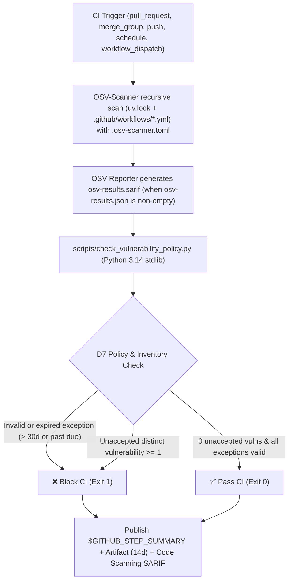
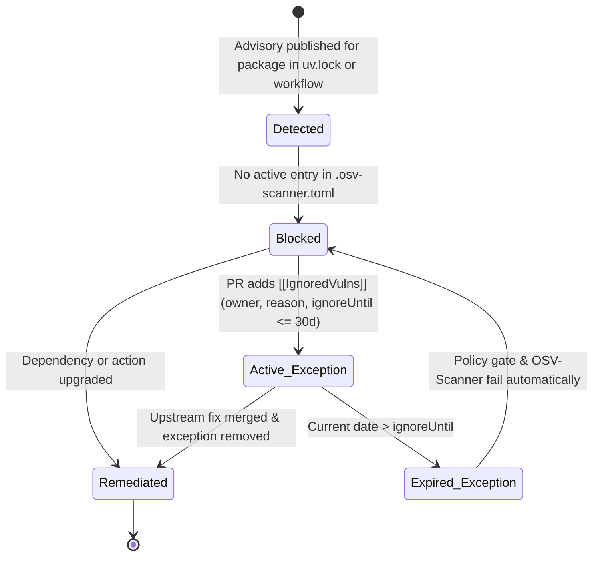

# Vulnerability & Dependency Management Policy (Decision D7)

**Repository:** `betagouv/2ddoc-parser`
**Architectural Decision:** `D7` (Accepted — 30-day maximum exception cap, full-inventory blocking gate across all CI events)
**Owner:** `@nicolasSagon`

---

## 1. Purpose and Scope

This document defines the enforceable vulnerability and dependency governance policy for **`2ddoc-parser`**. It aligns the library with **Document IA** architectural decision **D7**:

> *"A visible but non-blocking detection is not a risk decision. Any new unaccepted vulnerability and any expired exception must block delivery."*

The ratified **D7** parameters are:
- **Maximum exception horizon**: **30 days** (`DEFAULT_MAX_EXPIRATION_DAYS = 30`).
- **Enforcement mode**: **Full-inventory blocking gate** across all CI events (`pull_request`, `merge_group`, `push` on `main`/`develop`, weekly `schedule`, and `workflow_dispatch`).

The policy combines three complementary controls:
1. **Automated Dependency Updates (Dependabot)**: Keeps Python dependencies (`uv.lock` / `pyproject.toml`) and GitHub Actions workflows (`.github/workflows/*.yml`) up to date weekly with a 7-day supply-chain cooldown via [`.github/dependabot.yml`](../.github/dependabot.yml).
2. **Dependency & Workflow Vulnerability Control (OSV-Scanner & D7 Policy Gate)**: Recursively scans the repository (`--recursive ./`) covering both [`uv.lock`](../uv.lock) and GitHub Actions workflows (`.github/workflows/*.yml`), enforces the temporary exception rules in [`.osv-scanner.toml`](../.osv-scanner.toml) via [`scripts/check_vulnerability_policy.py`](../scripts/check_vulnerability_policy.py), and publishes deduplicated reports plus SARIF findings to GitHub Code Scanning.
3. **Local Secret Detection (Gitleaks Hooks)**: Prevents accidental secret leaks prior to commit (`pre-commit`) and prior to push (`pre-push` via [`scripts/gitleaks_pre_push.sh`](../scripts/gitleaks_pre_push.sh)) using [`.gitleaks.toml`](../.gitleaks.toml).

---

## 2. Automated Dependency Updates (Dependabot)

[`.github/dependabot.yml`](../.github/dependabot.yml) configures automated weekly update checks for the two ecosystems used in `2ddoc-parser`:

| Ecosystem | Directory | Schedule | Supply-Chain Cooldown | Max Open PRs | Grouping Strategy |
| :--- | :---: | :---: | :---: | :---: | :--- |
| `uv` | `/` | `weekly` | `7 days` | `10` | `uv-minor-patch` groups `minor` and `patch` updates (`patterns: ["*"]`); `major` updates open individual PRs for focused review. |
| `github-actions` | `/` | `weekly` | `7 days` | `5` | `actions` groups all workflow action updates (`patterns: ["*"]`). |

> [!TIP]
> The 7-day `cooldown` mitigates rapid supply-chain compromise scenarios (typosquatting / hijacked package releases) by delaying automated bumps of brand-new releases unless an urgent security advisory requires a manual upgrade.

---

## 3. Dependency Vulnerability Control Architecture (D7)

### 3.1. End-to-End CI Enforcement Flow

Unlike differential-only PR checks that miss newly published CVEs or newly expired exceptions on unchanged dependencies, [`.github/workflows/osv-scanner.yml`](../.github/workflows/osv-scanner.yml) runs a **full-inventory blocking gate** across all triggers (`pull_request`, `merge_group`, `push` on `main`/`develop`, weekly `schedule`, and `workflow_dispatch`). All workflow actions are pinned to immutable 40-character Git commit SHAs, workflow-level permissions default to `permissions: {}`, and `actions/checkout` enforces `persist-credentials: false`.



### 3.2. Distinguishing Distinct Vulnerabilities from Lockfile Occurrences

A raw OSV scan output must never be reported as a count of distinct vulnerabilities:
- A single advisory is frequently cross-published under multiple identifiers (`CVE-*`, `GHSA-*`, `PYSEC-*`) linked through exact `aliases` (and `groups` alias groupings). By contrast, `related` and `upstream` refer to distinct vulnerabilities and are **never** merged, preventing exception bypasses across separate advisories.
- A single vulnerability can affect multiple package entries or lockfile/workflow references.

[`scripts/check_vulnerability_policy.py`](../scripts/check_vulnerability_policy.py) computes three separate metrics using a **Union-Find (connected components)** algorithm over exact linked alias identifiers (`id ∪ aliases` across vulnerability entries and `groups`):

| Metric | Definition | Role in Policy Gate |
| :--- | :--- | :--- |
| **Distinct Unaccepted Vulnerabilities** | Connected components of exact linked vulnerability aliases (`CVE` / `GHSA` / `PYSEC`) not covered by an active D7 exception. Canonical ID prioritizes `CVE-*`, then `GHSA-*`, then `PYSEC-*`, then lexicographical order. | **Blocking metric** (`> 0` fails CI). |
| **Affected Package Occurrences** | Unique `(package_name, package_version, lockfile_path)` tuples impacted by at least one unaccepted vulnerability. | Operational remediation scope. |
| **Raw OSV Findings** | Unmerged count of vulnerability entries in `osv-results.json`. | Informational only (prevents inflation). |

---

## 4. Temporary Exception Governance (`.osv-scanner.toml`)

When an upstream fix is unavailable or a vulnerability lies in an unreachable code path, a temporary risk exception may be recorded in [`.osv-scanner.toml`](../.osv-scanner.toml) via Pull Request.

### 4.1. Mandatory Schema and Constraints

Every `[[IgnoredVulns]]` entry in [`.osv-scanner.toml`](../.osv-scanner.toml) is validated by [`scripts/check_vulnerability_policy.py`](../scripts/check_vulnerability_policy.py) against the following rules:

| Field | Format / Constraint | Failure Code on Violation |
| :--- | :--- | :--- |
| `id` | Official advisory ID matching `^(GHSA-[a-z0-9]{4}-[a-z0-9]{4}-[a-z0-9]{4}\|CVE-\d{4}-\d{4,}\|PYSEC-\d{4}-\d+)$`. Must be unique. | `INVALID_VULN_ID` / `DUPLICATE_VULN_ID` |
| `ignoreUntil` | Mandatory **unquoted** TOML date `YYYY-MM-DD` (`datetime.date`, neither a quoted string nor `datetime.datetime`, matching OSV-Scanner Go's TOML parser). Must satisfy `today <= ignoreUntil <= today + 30 days`. | `MISSING_IGNORE_UNTIL` / `INVALID_IGNORE_UNTIL` / `EXPIRED_EXCEPTION` / `EXCESSIVE_EXPIRATION_HORIZON` |
| `reason` | Mandatory string matching `^\[Owner:\s*@([A-Za-z0-9-]+)\]\s*(.{20,})$` (explicit GitHub owner handle + at least 20 characters of technical justification or compensating control). | `MISSING_REASON` / `INVALID_REASON_FORMAT` / `SHORT_REASON_JUSTIFICATION` |

> [!WARNING]
> Unbounded overrides (such as entries without `ignoreUntil`, quoted `ignoreUntil` strings, horizons exceeding **30 days**, or top-level keys other than `IgnoredVulns`) are automatically rejected by the CI policy gate.

### 4.2. Example of a Compliant Exception

```toml
[[IgnoredVulns]]
id = "GHSA-xxxx-yyyy-zzzz"
ignoreUntil = 2026-12-15
reason = "[Owner: @nicolasSagon] Vulnerable code path is never reached by 2ddoc-parser; waiting for upstream release vX.Y.Z."
```

### 4.3. Exception Lifecycle



---

## 5. Local Verification & Operational Runbook

### 5.1. Running the Policy Checks Locally

```bash
# 1. Validate .osv-scanner.toml governance rules (30-day max horizon, owner, justification)
uv run python scripts/check_vulnerability_policy.py \
  --config .osv-scanner.toml \
  --summary-output /tmp/vulnerability-summary.md

# 2. Validate against an OSV-Scanner JSON report
uv run python scripts/check_vulnerability_policy.py \
  --config .osv-scanner.toml \
  --osv-json osv-results.json \
  --summary-output /tmp/vulnerability-summary.md

# 3. Run the automated D7 policy test suite
uv run pytest tests/test_vulnerability_policy.py -v
```

### 5.2. Recommended GitHub Branch Protection Configuration

To make CI failures strictly enforceable at the repository level on `main`, configure the following GitHub Actions status checks as **Required Status Checks** in the repository's branch protection / rulesets:

- `OSV-Scanner & Politique D7` (from [`.github/workflows/osv-scanner.yml`](../.github/workflows/osv-scanner.yml))
- `lint-and-test` (from [`.github/workflows/pr-checks.yml`](../.github/workflows/pr-checks.yml))
